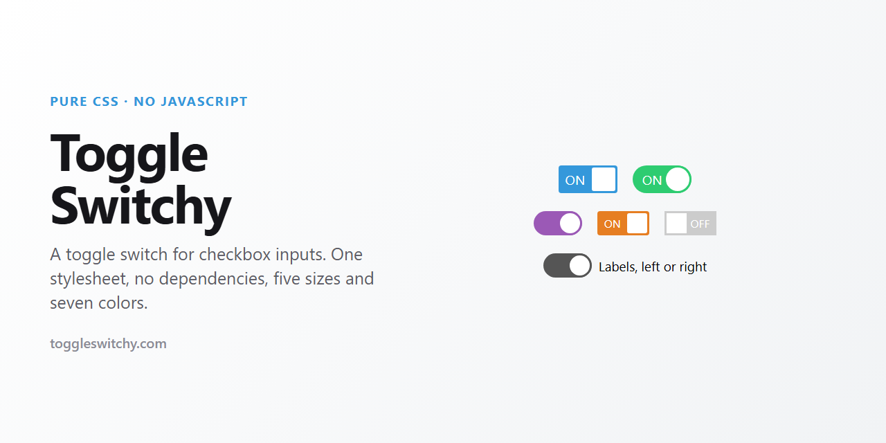

<p align="center">
  
</p>

<h1 align="center">Toggle Switchy</h1>

<p align="center">
  A CSS toggle switch for checkbox inputs. No JavaScript, no dependencies, one stylesheet.
</p>

<p align="center">
  <a href="https://toggleswitchy.com"><b>Try the live demo</b></a>
</p>

<p align="center">
  <a href="https://github.com/adamculpepper/toggle-switchy/blob/master/toggle-switchy.css"></a>
  
  
  <a href="https://github.com/adamculpepper/toggle-switchy/stargazers"></a>
  <a href="https://github.com/adamculpepper/toggle-switchy/blob/master/LICENSE"></a>
</p>

---

Toggle switches are one of those components that keep getting rebuilt. The usual options are a
framework you have to adopt for one control, a snippet that ships a pile of global styles, or a
JavaScript widget that replaces the checkbox with a div and loses the form behavior you wanted.

This is one stylesheet. Link it, put a class on a label, and the checkbox inside it becomes a
switch. The input stays a real `<input type="checkbox">`. It posts with the form and behaves like a
checkbox for anyone using a keyboard or a screen reader, because that is what it still is.

## What you get

- Five sizes, from extra small to extra large
- Seven colors, or your own by overriding two lines
- Rounded, square, or the default lightly rounded corners
- ON and OFF text built in, or switched off for a plain slider
- Labels on the left or the right
- Disabled and checked states, driven by the normal HTML attributes
- Focus styles, so keyboard users can see where they are
- No global styles. All 88 selectors are scoped under `.toggle-switchy`

## Install

Download [`toggle-switchy.css`](toggle-switchy.css) and link it:

```html
<link rel="stylesheet" href="toggle-switchy.css">
```

Or use the CDN:

```html
<link rel="stylesheet" href="https://cdn.jsdelivr.net/gh/adamculpepper/toggle-switchy@latest/toggle-switchy.css">
```

Then write a label with a checkbox inside it:

```html
<label class="toggle-switchy" for="notifications">
	<input type="checkbox" id="notifications" checked>
	<span class="toggle">
		<span class="switch"></span>
	</span>
</label>
```

With a text label beside the switch:

```html
<label class="toggle-switchy" for="notifications" data-label="left">
	<input type="checkbox" id="notifications">
	<span class="toggle">
		<span class="switch"></span>
	</span>
	<span class="label">Email notifications</span>
</label>
```

The `for` attribute and the input `id` have to match, which is what makes the whole label clickable.

## Options

Every option is a data attribute on the label.

| Option | Attribute |
| ------ | ------ |
| Size | `data-size="xl"`<br>`data-size="lg"`<br>medium (default, omit the attribute)<br>`data-size="sm"`<br>`data-size="xs"` |
| Color | `data-color="red"`<br>`data-color="orange"`<br>`data-color="yellow"`<br>`data-color="green"`<br>`data-color="blue"` (default)<br>`data-color="purple"`<br>`data-color="gray"` |
| Style | `data-style="rounded"`<br>`data-style="square"`<br>default is lightly rounded |
| Text | `data-text="false"` removes the ON and OFF text |
| Label position | `data-label="left"`<br>right is the default |
| Checked | the `checked` attribute on the input |
| Disabled | the `disabled` attribute on the input |

They combine, so `data-size="xs" data-style="rounded" data-color="green" data-text="false"` is a
small round green switch with no text on it. The [demo](https://toggleswitchy.com) has every
combination side by side.

## Recoloring it

The top of the stylesheet is a block marked `Customizable styles`, above a block marked
`CORE STYLES BELOW - NO TOUCHY`. The split is deliberate: the top holds the colors, the ON and OFF
text and the corner radius, and the bottom holds the mechanics that make the switch slide. Change
the top and nothing breaks.

To use a brand color rather than one of the seven, override the checked state:

```css
.toggle-switchy > input:checked + .toggle {background:#ff6600;}
.toggle-switchy > input:checked + .toggle > .switch {border-color:#ff6600;}
```

To change the text:

```css
.toggle-switchy > input + .toggle:before {content:'YES';}
.toggle-switchy > input + .toggle:after  {content:'NO';}
```

## Accessibility

The checkbox is a real input. It is hidden with `opacity:0` and positioned absolutely rather than
`display:none`, which matters: a display-none input is removed from the accessibility tree and
cannot be focused. This one keeps its place in the tab order, announces its checked state, and
toggles with the space bar.

Focus and active states get a visible ring, so keyboard users can see which control they are on.
Because the markup is a `<label>` wrapping its own input, clicking anywhere on the switch or its
text toggles it, with no JavaScript involved.

## Browser support

Works in current versions of Chrome, Edge, Firefox and Safari. IE10 and below render the switch but
without the sliding transition.

## Related

[Toggle Radios](https://github.com/adamculpepper/toggle-radios) does the same thing for radio
buttons.

## License

MIT. See [LICENSE](LICENSE).
